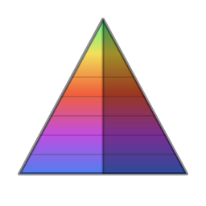

<div align="center">



# nyi

**an animated 3D fetch tool.**

`donut.c` had a baby with `neofetch`. Your distro logo gets extruded into a
solid, lit from an angle you pick, and spun in your terminal while the system
info renders next to it.

[](LICENSE)


</div>

---

## it runs where you run

<table>
<tr>
<td width="33%" align="center"><br><sub><b>Linux</b> · desktop</sub></td>
<td width="33%" align="center"><br><sub><b>Linux</b> · laptop</sub></td>
<td width="33%" align="center"><br><sub><b>macOS</b></sub></td>
</tr>
<tr>
<td align="center"><br><sub><b>Android</b> · Termux</sub></td>
<td align="center"><br><sub><b>iOS</b> · iSH / NewTerm</sub></td>
<td align="center"><sub>same binary, no runtime deps</sub></td>
</tr>
</table>

## what it does

- **real 3D.** the logo is extruded into a solid and shaded per-pixel from a
  configurable light direction — not a pre-rendered animation.
- **native info.** everything comes straight out of `/proc`, `/sys`, sysctl,
  DRM/EDID and your GTK config. no runtime dependencies.
- **any logo.** ships with its own pyramid, and borrows any logo `fastfetch`
  knows (`nixos`, `arch`, `gentoo`, `debian`, `void`, …) when it's installed.
  drop in your own ASCII art too.
- **sub-cell shading.** `sextants` (2×3) and `blocks` (2×2) modes for terminals
  that draw the Symbols for Legacy Computing block, or a plain ASCII ramp
  everywhere else.
- **mobile aware.** knows Termux (`getprop`, `$PREFIX` dpkg) and iSH.
- **declarative.** first-class Nix flake with NixOS and home-manager modules.

## install

<details open>
<summary><b>Nix</b> (flake)</summary>

```bash
nix run github:elwrcl/nyi
```

Or add it to your flake inputs and pull in the module — see
[Nix modules](#nix-modules) below.

</details>

<details>
<summary><b>From source</b> (any distro)</summary>

Needs Rust 1.74 or newer.

```bash
git clone https://github.com/elwrcl/nyi
cd nyi
make
sudo make install          # installs to /usr/local/bin
```

`PREFIX` and `DESTDIR` work the way you'd expect:

```bash
make install PREFIX="$HOME/.local"
```

</details>

<details>
<summary><b>Fedora / RHEL / openSUSE</b> (rpm)</summary>

```bash
rpmbuild -ba nyi.spec
```

The spec pulls the `main` tarball and builds with `make`. Note that `cargo`
needs network access to fetch `libc` — vendor it first if you're building in a
sandbox like OBS or Koji.

</details>

<details>
<summary><b>Android</b> (Termux)</summary>

```bash
pkg install rust make git
git clone https://github.com/elwrcl/nyi && cd nyi
make && make install PREFIX="$PREFIX"
```

</details>

<details>
<summary><b>iOS</b> (iSH)</summary>

iSH emulates a 486-class x86 with no SSE, so the usual `i686` build traps on
its first floating-point instruction. Cross-compile for `i586` instead — the
result is a static musl binary with nothing to install alongside it:

```bash
make ish          # -> dist/nyi-ish, 636K, statically linked i386
```

Put it in iCloud Drive, then in iSH:

```sh
mkdir -p /mnt/icloud
mount -t ios . /mnt/icloud      # pick the folder in the iOS file picker
install -m 755 /mnt/icloud/nyi-ish /usr/local/bin/nyi
nyi --frames 60
```

Everything is emulated, so keep `--frames` modest. a-Shell can't run this —
it's not an emulator, and iOS won't execute a downloaded ELF.

</details>

## usage

```bash
nyi                        # spin the detected distro logo next to your info
nyi -l nixos               # borrow a fastfetch logo
nyi --infinite --speed 2   # run until you hit a key
nyi --no-info --size 2     # just the shape, twice as big
```

| flag | what it does |
| --- | --- |
| `-l, --logo <name>` | use a logo by name. `triangle` (aka `pyramid`, `nyi`) is built in; anything `fastfetch --list-logos` prints also works |
| `--rotate-x` / `--rotate-y` | lock rotation to one axis |
| `-s, --speed <float>` | rotation speed multiplier (default `1.0`) |
| `--size <float>` | logo scale, `0.5`–`5.0` |
| `--depth <float>` | extrusion depth, `0.1`–`10.0`. unset, it's derived from the logo's character variance so flat art doesn't look paper-thin |
| `--height <n>` | render height in rows. unset, it matches the info block |
| `--no-info` | logo only |
| `--no-color` | drop the logo coloring |
| `--frames <n>` | stop after `n` frames (default `2000`) |
| `--infinite` | run forever — any key or `Ctrl-C` exits |
| `--shading-mode <mode>` | `ascii` (default), `blocks` (2×2) or `sextants` (2×3) |
| `--shading-chars <str>` | custom ramp, dimmest first. UTF-8 is fine |
| `--box` | draw a border around the info block |
| `--config <path>` | use this config instead of the default |
| `--dump-logo <name>` | print a logo in `logo.txt` form, taken from fastfetch |
| `--fetch-logo <name>` | the same, downloaded — for machines without fastfetch |
| `-V, --version` · `-h, --help` | version / help |

Sub-cell modes need a terminal that renders the Symbols for Legacy Computing
block — kitty, Ghostty, foot and NewTerm all do.

## configuration

`$XDG_CONFIG_HOME/nyi/config`, defaulting to `~/.config/nyi/config`.

List the field names you want, one per line, **in display order**. Delete or
comment out a line to hide that field. Settings go in the same file as
`key=value` and are order-independent.

```ini
# fields, in the order they're drawn
os
kernel
uptime
packages
shell
wm
terminal
cpu
gpu
memory
disk
colors

# an extra mount point beyond / (repeatable, up to 8)
disk=/home

# settings
label_color=magenta        # red green yellow blue magenta cyan white, or "38;5;213"
separator=-                # repeated under the user@host title; "" leaves it blank
box=0
shading_mode=sextants
logo_outer=magenta         # extruded sides
logo_inner=white           # front and back faces
light=top-left             # top-left top-right top left right front bottom-left bottom-right
spin=xy                    # x, y or xy
speed=1.0
size=1.0
depth=1.0
height=20
```

<details>
<summary>all available fields</summary>

`os` `host` `kernel` `uptime` `packages` `shell` `display` `wm` `theme`
`icons` `font` `cursor` `terminal` `cpu` `gpu` `memory` `swap` `disk` `ip`
`battery` `locale` `colors`

</details>

### borrowing a logo without fastfetch

`fastfetch` keeps its ~500 logos as string literals compiled into a 3.2 MB
binary. nyi doesn't carry them, and it doesn't reach for the network while it
draws either — a fetch tool that blocks your shell on a DNS lookup is a broken
fetch tool. Instead you export a logo once, and it becomes an ordinary
`logo.txt`:

```bash
# on a machine that has fastfetch
nyi --dump-logo apple > ~/.config/nyi/logo.txt

# on one that can't run it — iSH, a lean Termux, a container
nyi --fetch-logo apple > ~/.config/nyi/logo.txt
```

`--fetch-logo` pulls a single text file from [`logos/`](logos) over `curl` or
`wget`. It is the only thing in nyi that opens a socket, it only runs when you
name it on the command line, and it shells out rather than linking a TLS stack
— one `libc` dependency is why the binary is 600 KB. Point it somewhere else
with `NYI_LOGO_URL` if you'd rather host your own.

The `logos/` directory is generated, not maintained by hand:

```bash
make && ./tools/dump-logos.sh
```

### your own logo

Drop ASCII or Unicode art in `$XDG_CONFIG_HOME/nyi/logo.txt`. Denser
characters (`@`, `M`, `#`) come out taller in the relief, sparse ones (`.`,
`,`) stay low — the art doubles as a heightmap. ANSI colors in the file are
preserved; without them, `logo_outer` / `logo_inner` decide the palette.

An optional first line picks a distro's color scheme:

```
# distro: nixos
```

## Nix modules

```nix
{
  inputs.nyi.url = "github:elwrcl/nyi";
}
```

Then, in a NixOS or home-manager configuration:

```nix
{
  imports = [ inputs.nyi.nixosModules.default ];    # or homeManagerModules.default

  programs.nyi = {
    enable = true;
    info = [ "os" "kernel" "uptime" "cpu" "memory" "colors" ];
    labelColor = "38;5;213";
    shadingMode = "sextants";
    light = "top-left";
    spin = "xy";
    disks = [ "/home" ];
  };
}
```

Every option is documented in [`nix/settings.nix`](nix/settings.nix). Anything
the module doesn't cover yet goes through `extraConfig`, which is appended to
the generated config verbatim. There's an overlay at `overlays.default` if you
just want the package.

## building

```nix
nix develop        # cargo, rustc, clippy, rustfmt, rust-analyzer, fastfetch
```

```bash
make               # release build, copied to ./nyi
make check         # --version and a one-frame smoke test
cargo test         # unit tests
cargo clippy --all-targets -- -D warnings
cargo fmt --check
```

The build stamps a codename into `--version` via `NYI_CODENAME`; the Makefile
and the Nix package both pass `nyiotxa`.

## license

[ISC](LICENSE) © elwrcl
